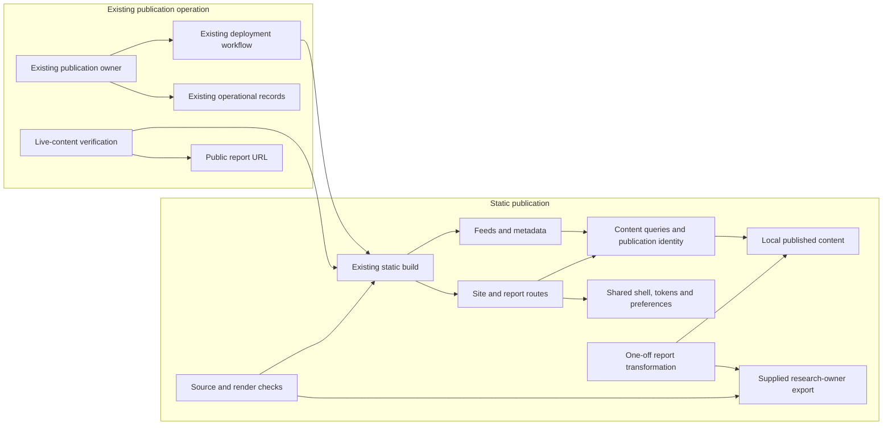

# DESIGN: Tom Scholtes editorial experience and G183 publication

**Size:** epic
**Authored:** 2026-10-28, planner gpt-6-astra (Factory-configured native Codex planner)

## 1. Stack decision

**Stack-key:** node

### Choice

Continue the existing Astro static site with TypeScript, JavaScript, semantic HTML and native CSS, built with Node.js and npm and hosted on GitHub Pages through `.github/workflows/deploy.yml`. Reuse `tomscholtes93-collab/tomscholtes93-collab.github.io`, its content collection, localization, shared components, paragraph anchors, feeds, font/image scripts and URL checks. Retain React, React DOM and `@astrojs/react` for existing islands, the existing comments integration, and self-hosted Instrument Serif, Inter and JetBrains Mono. New reading features use static markup and progressive enhancement. This improves an established publication without replacing its content or routing infrastructure.

Use the supplied job-local Node.js 24.22.1 and npm 11.19.1. The existing workflow already selects Node.js 24. The lockfile starts at Astro 5.18.1, but INTENT records a critical advisory and authorizes a narrow same-framework security upgrade. Start remediation with Astro 7.4.1, the recorded audit-recommended target, whose package metadata and release were verified. Select the minimum compatible integrations and declarations using dependency metadata, the actual audit and production-build evidence. Latest releases in the table are observations, not blanket upgrade instructions. [Target metadata](https://registry.npmjs.org/astro/7.4.1), [target release](https://github.com/withastro/astro/releases/tag/astro%407.4.1).

The compatibility work must preserve content identity, paragraph anchors and rendered prose. The existing collection API needs adaptation across the major upgrade. Astro's documented compatibility path through `@astrojs/markdown-remark` can retain the existing paragraph transform; whitespace behavior also needs explicit preservation. These are bounded compatibility changes, not permission to rewrite content. [Collection migration](https://docs.astro.build/en/guides/upgrade-to/v6/), [rendering migration](https://docs.astro.build/en/guides/upgrade-to/v7/).

### Alternatives considered

#### Alternative A: Next.js with static export

**Rejected because:** Static export supports the existing hosting, and its current Node.js requirement is satisfied by this host. Installation would require project dependencies, not another host runtime. Adoption would nevertheless replace Astro templates, collection rendering and route generation across four locales, including paragraph addresses and reply identity. Those preservation costs do not serve an additional requirement in this editorial task. [Package metadata](https://registry.npmjs.org/next/latest), [static export documentation](https://nextjs.org/docs/app/guides/static-exports).

#### Alternative B: Eleventy

**Rejected because:** Eleventy is a viable static editorial platform and runs on the supplied Node.js runtime with a project-local installation. It would require replacing templates and reconnecting existing islands, collection transforms, localization and metadata. Its simpler template model does not remove that migration cost for this established site. [Official installation documentation](https://www.11ty.dev/docs/).

### Verified versions

Current means the upstream release observed on the verification date. Seed versions come from the inspected lockfile; runtime versions come from the Factory's supplied host verification. Managed services and living standards have no single installable application version. Registry metadata was fetched directly where the web viewer could not retrieve it.

| Technology | Current version | Source (URL) | Verified (YYYY-MM-DD) |
|---|---|---|---|
| Astro | 7.4.3; seed 5.18.1; initial remediation target 7.4.1 | [Latest metadata](https://registry.npmjs.org/astro/latest), [target metadata](https://registry.npmjs.org/astro/7.4.1) | 2026-10-28 |
| TypeScript | 7.0.2; seed 5.9.3 | [Registry](https://registry.npmjs.org/typescript/latest) | 2026-10-28 |
| JavaScript | ECMAScript 2026, 17th edition | [Ecma standard](https://ecma-international.org/publications-and-standards/standards/ecma-262/) | 2026-10-28 |
| HTML | Living Standard, updated 2026-10-26 | [WHATWG standard](https://html.spec.whatwg.org/multipage/) | 2026-10-28 |
| CSS | Snapshot 2026; modules version separately | [W3C snapshot](https://www.w3.org/TR/css/) | 2026-10-28 |
| Node.js | 26.13.0 latest; supplied runtime 24.22.1 | [Official release index](https://nodejs.org/dist/index.json) | 2026-10-28 |
| npm | 12.2.1 latest; supplied runtime 11.19.1 | [Registry](https://registry.npmjs.org/npm/latest) | 2026-10-28 |
| React | 19.3.1; seed 18.3.1 | [Registry](https://registry.npmjs.org/react/latest) | 2026-10-28 |
| React DOM | 19.3.1; seed 18.3.1 | [Package versions](https://www.npmjs.com/package/react-dom?activeTab=versions) | 2026-10-28 |
| `@astrojs/react` | 7.1.1; seed 4.4.2 | [Registry](https://registry.npmjs.org/@astrojs/react/latest) | 2026-10-28 |
| `@astrojs/markdown-remark` | 7.3.5 | [Registry](https://registry.npmjs.org/@astrojs/markdown-remark/latest) | 2026-10-28 |
| Instrument Serif through Fontsource | Package 5.3.0; seed 5.2.8 | [Package](https://www.npmjs.com/package/%40fontsource/instrument-serif) | 2026-10-28 |
| Inter through Fontsource | Package 5.3.0; seed 5.2.8 | [Registry](https://registry.npmjs.org/@fontsource/inter/latest) | 2026-10-28 |
| JetBrains Mono through Fontsource | Package 5.3.0; seed 5.2.8 | [Package versions](https://www.npmjs.com/package/%40fontsource/jetbrains-mono?activeTab=versions) | 2026-10-28 |
| GitHub Pages and Actions | Managed services; reuse existing workflow | [Official workflow documentation](https://docs.github.com/en/pages/getting-started-with-github-pages/using-custom-workflows-with-github-pages) | 2026-10-28 |
| giscus | Hosted integration with an unversioned script URL; disabled in the seed configuration | [Official integration documentation](https://giscus.app/) | 2026-10-28 |
| Next.js, alternative only | 16.4.3 | [Registry](https://registry.npmjs.org/next/latest) | 2026-10-28 |
| Eleventy, alternative only | 3.1.7 stable | [Official release listing](https://www.11ty.dev/) | 2026-10-28 |

## 2. Architecture spine

Arrows mean “depends on.” Units are logical boundaries within the existing site and publication operation, not additional services.



- **INV-1 Static reading:** Primary navigation, published prose, citations and fragment targets remain usable without client initialization or scroll-triggered revelation.
  - Diverge test: Yes. A shell builder could hide sections pending animation while a report builder assumes its rendered prose is immediately readable.
  - Non-obvious: Yes. The reference presentation encourages scroll-dependent reveal effects.
  - Trade-off: Reliable reading limits choreography while permitting decorative enhancement.

- **INV-2 Shared appearance state:** Shared tokens and the existing display-preference subsystem exclusively own site-wide appearance state, which page and report components consume.
  - Diverge test: Yes. Independent layouts could introduce incompatible root attributes, density values or theme palettes.
  - Non-obvious: Yes. Convenient component-local styling can conflict with existing preference restoration and navigation behavior.
  - Trade-off: Appearance changes require coordination in exchange for consistent controls and typography.

- **INV-3 One publication identity:** Routes, discovery, feeds, metadata and comments derive publication status, stable unlocalized slug and actual locale availability from one content authority.
  - Diverge test: Yes. Separate consumers could expose drafts, advertise absent translations or split one report into several discussion identities.
  - Non-obvious: Yes. Existing pages duplicate filters, and both the shell and language switcher assume four translations.
  - Trade-off: Touched consumers share publication decisions instead of independently reconstructing them.

- **INV-4 Source authority:** G183 substance comes exclusively from the supplied research-owner report, with permitted presentation transformations accounted for against that source.
  - Diverge test: Yes. An importer could summarize the source while presentation advertises the complete report.
  - Non-obvious: Yes. Turning a long research document into a web page invites editorial shortening and invented connecting material.
  - Trade-off: Full-source comparison and bounded transformation replace unrestricted rewriting; ordinary builds consume only local content.

- **INV-5 Operational ownership:** Existing operational owners bind reviews, candidate identity, authentication and deployment evidence; product code consumes neither those records nor a new release-readiness contract.
  - Diverge test: Yes. An importer and publisher could independently implement conflicting acceptance rules or duplicate release stages.
  - Non-obvious: Yes. Automating a unified readiness checker appears convenient but creates a second orchestration authority.
  - Trade-off: The existing owner performs a concrete one-off handoff, while executable checks remain limited to source/render fidelity and live content.

INTENT preserves existing content, URLs, EN/DE/FR/RU, RSS, comments, display controls, contact links and the 2026-07-22 privacy cut. Existing decisions remain applicable except where INTENT explicitly supersedes them. The recorded publication authorization permits this report's publication transition without another personal approval gate. Required independent technical reviews remain binding.

## 3. Data ownership

| Data | Owner (the one unit allowed to mutate it) | Who else may read it | Mutation path |
|---|---|---|---|
| Original report, citations and substantive corrections | Existing research owner | Importer and reviewers through the supported handoff | Owner supplies a source revision with its provenance |
| Local content bodies, publication status, slug and locale editions | Existing content publication unit | Routes, queries, feeds, metadata and comments | Existing editorial path; bounded G183 import followed by the authorized publication transition |
| Source-to-render correspondence | One-off report transformation/check | Importer, reviewers and publisher | Derive from the supplied source, permitted transformations and actual rendered output |
| Shared shell, tokens and interface translations | Site-experience unit | All presentation components | Reviewed edits to shared sources |
| Persisted display preferences and root-state projection | Existing display-preference subsystem | Shell and presentation components | User control events and existing restoration behavior |
| Comment bodies | Existing external comments service | Readers and the existing client integration | Existing reader interaction; never imported into build content |
| Generated pages, assets, sitemap and feeds | Existing build pipeline | Browser checks and publisher | Regenerate from the candidate; no manual output edits |
| Review verdicts | Independent reviewer for each invocation | Factory and publisher | Original immutable result bound to its actual target |
| Handoff, deployment evidence and revert instructions | Existing publication owner | Reviewers and Tom | Append actual evidence to the existing operational ledger |

INTENT records the completed 80,088-byte source handoff, original source ledger `DONE` and `source_scope_complete=true`. The candidate input is the supplied report with SHA-256:

```text
8ac43988f501241c62002f6206f04c04d794e9a7cb888406345a18b99bf23d22
```

Three distinct facts govern its use:

- Research-owner provenance establishes where the complete source came from.
- Independent review has technically accepted that exact source's scope and public-copy suitability, with bounded primary-source spot checks and recorded limitations.
- Tom has already authorized publication under option A. This does not claim he personally reviewed the bytes, and no new personal approval is required.

The accepted presentation transformations are heading normalization, contents and reading aids, accurate AI-authorship disclosure, metadata and removal of the opening direct address to Tom. Preserve every substantive section, citation and the full story. The first body line carries the applicable machine-authorship disclosure. Any substantive correction remains with the research owner; changes outside the accepted transformation scope need affected technical evidence refreshed, not an invented personal byte-approval gate.

A small rerunnable transformation/check receives the supported local export, checks its hash, and compares source sections, complete substantive text, citations and reading links with the imported and rendered document. It must account for the October 2026 baseline, granular roadmap through 2046 and full imagined future story. Counts and headings alone cannot prove completeness. Missing input, mismatched bytes, unsafe markup or unexplained content loss fail the affected check without altering existing publications. Neither importer nor build retrieves hidden sibling-job storage.

The one-off handoff is a procedure using existing records:

1. The publisher references the completed source receipt, exact-hash technical acceptance, accepted transformations and existing publication authority in the operational ledger. The importer receives the source file and expected hash, with no dependency on a release receipt schema or readiness command.
2. Import explicitly as draft. The publisher prepares the intended published state on an isolated, unpublished candidate branch under the existing authorization. Required producer and integrated-candidate reviews cover the actual intended publication bytes, including status. No production preview endpoint or additional release state machine is needed.
3. Record the integrated commit/tree, source comparison, original independent verdicts, quality-gate and browser results. Candidate changes require refreshed affected checks and review. Preserve prior valid failures and actual attempts.
4. Before the external operation, the publisher verifies established repository write access, records the previously deployed commit and concrete release commits, and deploys the reviewed candidate through the existing workflow. Record the real run, head commit and deployment result in the operational ledger.
5. Run narrowly scoped read-only checks against the actual report URL and compare it with the reviewed rendered report. Retain live browser evidence and concrete commit-specific revert commands, followed by the existing redeployment and verification steps. Reversion must preserve unrelated later work.

Specifications and tickets must implement this as documentation and existing operational activity. Source/render checks and live-content checks may be executable. They must not validate review schemas, authentication, workflow identity or release stages, manufacture acceptance records, or become importer prerequisites. Those responsibilities stay with the existing publication owner and Factory lane.

Operational receipts and restricted evidence remain outside public content, metadata and build output. Readers receive useful citations and accurate authorship disclosure, without a new public provenance interface.

## 4. Experience

The front door remains a publication with a clear masthead, readable notes and direct paths to topics and archive. About, projects, CV, thesis and contact remain reachable. Apply the observed section labels, action hierarchy, modular cards and useful sequencing from `.factory/REFERENCE-ANALYSIS.md` within Tom's existing visual system. Reference text, logos, illustrations and source implementation are not inputs.

G183 joins the existing reading pathways as a complete document. Its introduction and relevant sections explicitly distinguish sourced October 2026 facts, forward-looking assumptions and fictional narrative. Contents links lead to actual sector, time-horizon and story sections. Citations stay associated with their claims, with sources and further reading accessible throughout.

Desktop may place contents beside the reading column. Narrow layouts use document flow and optional native `details`/`summary` for navigation. The report body remains readable without opening successive disclosures. Labels convey evidence categories in text as well as visual styling. Existing Cyrillic typography remains supported.

Required states include:

- Keyboard and touch navigation, visible focus, accurate expanded/current states, menu dismissal and unobscured fragment targets.
- Disabled scripting, reduced motion and failed optional enhancement.
- Existing themes and densities, restoration after navigation and useful defaults when storage fails.
- Actual report editions and unavailable translations, with links to an available edition or the selected locale's index rather than nonexistent translated pages.
- Disabled or unavailable comments, retaining static reply links and the existing integration state.
- A missing or invalid local report input, which leaves existing pages buildable and emits no fabricated report or public placeholder.

The browser baseline identifies 32px overflow at a 320px viewport, a mobile menu that does not close with Escape, and no outer-document h1 on `/cv/`. Address these in the relevant site work, inspecting the embedded CV before changing its semantics. Preserve the baseline's readable no-JavaScript and reduced-motion behavior. `/tags/` is the actual tags route.

Acceptance covers widths 320, 390, 768 and 1440, representative existing routes across all four locales and every imported report edition. Exercise menu lifecycle, focus, contents, direct fragments, back navigation, display preferences, fonts, assets, citations, feeds and canonical/alternate metadata. Compare loading behavior under equivalent baseline conditions. Preserve locked addresses and existing paragraph links; do not update `urls.lock` to conceal a loss.

The frozen integration command is `bash scripts/quality-gate.sh`, including `npm run build` and the applicable standards checks. The wrapper is absent from the inspected seed and must be supplied by implementation. Preserve the recorded audit baseline, but do not turn unresolved high or critical findings into a green release. The authorized security compatibility work must satisfy the actual quality standard and demonstrate preserved static output and browser behavior.

Site-experience implementation and review remain independently launchable. The source handoff and technical acceptance are complete as recorded in INTENT; report transformation and integration still require their own checks. Existing GitHub write credentials remain an external deployment prerequisite, with recorded failures rather than verified access. Local work continues without treating credentials as an implementation dependency.

Live verification must inspect the actual report URL on `tomscholtes.com`, reject homepage fallbacks and wrong editions, compare the report body with reviewed output, and exercise representative baseline, roadmap and story passages, citations, assets and fragments on desktop and mobile. Workflow success or HTTP 200 alone cannot establish publication.

## 5. Deferred

- Exact spacing, breakpoints, card arrangements, contents placement and decorative motion, within shared tokens and static reading.
- Report title, initial slug and edition metadata derived during import from the supplied source. The export is already supplied; no new personal approval is awaited. The slug becomes stable at first publication.
- Minimal collection and rendering adaptations, including compatibility changes required by the authorized framework update. Their precise APIs and fields belong to implementation.
- Final dependency pins and quality-tool choices after compatibility and audit verification. The frozen integration entry point remains unchanged.
- Cleanup of unrelated duplicated filters, locale tables and components. Touch consumers only where preservation or publication consistency requires it.

A generalized admission system, executable release-readiness subsystem, additional credential machinery and personal byte-approval gate are excluded from this project, not deferred features.

## 6. Seed

The stack, dependency versions, file tree and data shapes below describe the cold start. After implementation begins, code and the lockfile own them; this section is history, not a contract. The lasting decisions are the dependency, authority and state boundaries above.

```text
.factory/
  INTENT.md
  REFERENCE-ANALYSIS.md
  BROWSER-BASELINE.md
  AUDIT-BASELINE.md
  config.json
.github/workflows/deploy.yml
docs/
  DECISIONS.md
  adr/
  agents/
src/
  components/
    Nav.astro
    LangSwitcher.astro
    NoteCard.astro
    ReplySurface.astro
    GiscusThread.astro
    islands/DisplayPanel.jsx
  config/comments.ts
  content/
    config.ts
    notes/
      config.ts
      en/
      de/
      fr/
      ru/
  i18n/
  layouts/Base.astro
  lib/
    notes.ts
    rss.ts
    rehype-note-paragraph-anchors.mjs
  pages/
    index.astro
    notes/
    tags/
    de/
    fr/
    ru/
  styles/
    tokens.css
    global.css
    components.css
    pages.css
scripts/
  check-i18n.mjs
  check-notes.mjs
  check-urls.mjs
  copy-fonts.mjs
  make-og.mjs
  post-build.mjs
public/
  fonts/
  CNAME
astro.config.mjs
package.json
package-lock.json
urls.lock
```

Start by reusing the notes collection and detail routes for G183, adding only the presentation support its complete structure needs. The framework upgrade may relocate collection configuration and change query/render APIs while preserving content identity.

```text
Existing note identity:
  locale directory + unlocalized slug

Existing frontmatter:
  title
  summary: at most 220 characters
  publishDate
  tags: at most three
  related: unlocalized slugs
  sources: [{ label, kind, href? }]
  status: draft | published

Existing body:
  authored prose, rendered with paragraph anchors
```

The schema defaults status to published, so import must explicitly set draft. Existing tags are positionally aligned across translations; current checks enforce counts rather than semantic order. Existing locale links assume all editions exist, which needs correction for actual report availability.

Display preferences currently use `ts-display-prefs`; report presentation adds no competing persistence. Comments are currently disabled while static reply links remain available.

Likely additions are a short publication procedure under `docs/agents/`, the required quality wrapper, and small source/render and live-content checks under `scripts/`. No operational receipt schema, readiness service or release-stage validator is seeded.

This read-only revision inspected repository files and recorded evidence, and verified upstream versions. It did not install dependencies, build a changed candidate, perform independent acceptance or deploy.

## 7. ADRs

- docs/adr/0001-retain-static-publication-stack.md: Retain the static publication architecture and bound the authorized security compatibility upgrade.
- docs/adr/0002-admit-owner-report-with-stable-identity.md: Use the completed source handoff, one publication identity and existing operational ownership without a new approval or readiness subsystem.
